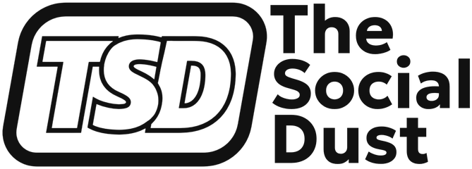
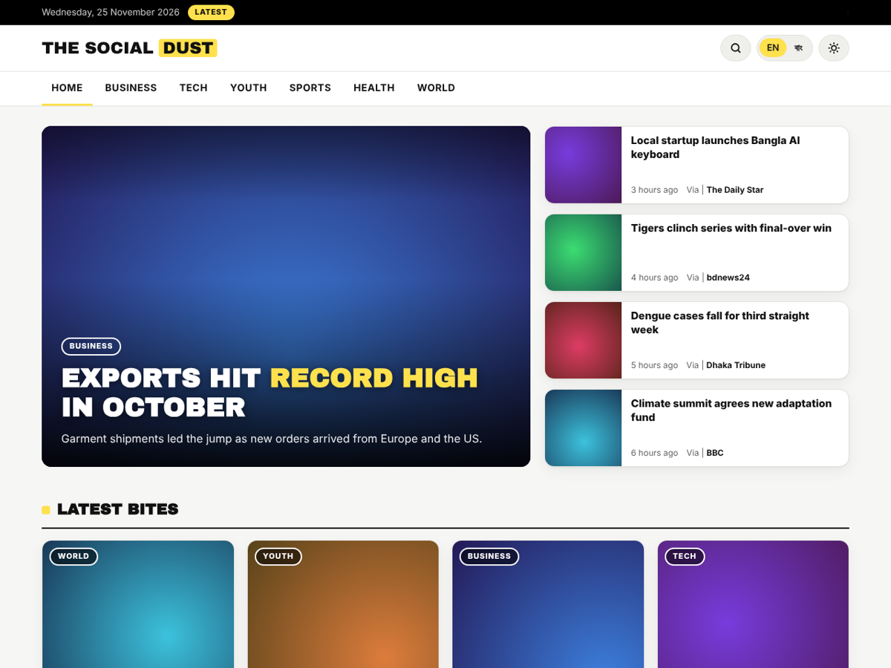

<p align="center">
  
</p>

<h1 align="center">The Social Dust: WordPress theme</h1>

<p align="center"><strong>Your world, in every scroll.</strong><br>
Bite-size news from Bangladesh and the world, in English and বাংলা.</p>



## Features

- **Six news sections:** Business, Tech, Youth, Sports, Health and World, created automatically with their Bangla names.
- **English / বাংলা switch:** every headline, summary, story, menu and label switches instantly, and the choice is remembered. Links can force a language with `?lang=bn`.
- **Dark / light mode:** follows the visitor's device on the first visit, then remembers their choice.
- **Bite-size layout:** lead story, "Latest" ticker, square story cards, yellow highlighted headline words, "Via | source" on every story.
- **67 stories included:** posts from @thesocialdust on Instagram, ready to import with one click.
- **Pages built in:** About, Contact (form that emails `hello@` or `ad@`), Privacy Policy and Terms & Conditions, all bilingual.
- **Newsletter signup:** subscribers are saved in WordPress and can be downloaded as CSV.
- **Search:** finds English and Bangla headlines and summaries.
- **Animations:** gentle scroll and hover effects, switched off for visitors who prefer reduced motion.
- **Your brand:** TSD logo, favicon, black / white / yellow (#FFE14D) and Archivo Black headlines.

## Requirements

- WordPress 6.0 or newer
- PHP 7.4 or newer

## Install

1. Download this repository as a zip: **Code → Download ZIP** on GitHub.
2. Unzip it, rename the folder to `thesocialdust` and zip the folder again. (WordPress expects the folder name without the `-main` that GitHub adds.)
3. In WordPress go to **Appearance → Themes → Add New → Upload Theme**, choose the zip and click **Activate**.
4. A yellow box appears at the top of WP Admin. Click **Import 67 stories now** and keep the page open until it finishes.
5. Go to **Settings → Permalinks** and choose **Post name**.
6. Optional: **Appearance → Customize → The Social Dust** for the default language, footer text and social links.

Developers can instead clone the repository straight into `wp-content/themes/thesocialdust`.

## Before launch

- Create the inboxes **hello@thesocialdust.com** and **ad@thesocialdust.com**.
- Install **WP Mail SMTP** so contact-form emails are delivered, then send yourself a test message.
- Have a Bangla speaker check the Bangla text on the About, Privacy and Terms pages.

## Posting a bite-size story

- **Title:** English headline. **Content:** the English story (2 to 4 short paragraphs).
- **Featured image:** the post graphic (square works best).
- **Category:** one of the six.
- In the box **The Social Dust: Bangla version & source**, fill in the Bangla headline, the English and Bangla summaries (about 30 words), highlight words (shown in yellow), source name and link, image credit and the Instagram post link.
- Any Bangla field left empty shows the English text instead.

## Where things are in WP Admin

| Menu | What it does |
|---|---|
| **Messages** | Every contact-form message, also emailed to hello@ or ad@ |
| **Newsletter** | Subscribers, search, remove, **Download CSV** |
| **Tools → Import TSD posts** | Import the bundled stories or upload a new `tsd-import.zip` batch |
| **Appearance → Customize → The Social Dust** | Default language, dark-mode logo, footer text, social links |

## Posting through the REST API (automation)

Create an Application Password (**Users → Profile → Application Passwords**), then:

```
POST /wp-json/wp/v2/posts
{
  "title": "Exports hit record high in October",
  "content": "<p>English story…</p>",
  "status": "draft",
  "categories": [<business category id>],
  "featured_media": <media id>,
  "meta": {
    "tsd_title_bn": "অক্টোবরে রপ্তানি রেকর্ড উচ্চতায়",
    "tsd_bite_en": "Garment shipments led the jump…",
    "tsd_bite_bn": "পোশাক রপ্তানি সবচেয়ে বেশি বেড়েছে…",
    "tsd_content_bn": "বাংলা বিস্তারিত…",
    "tsd_highlight": "record high",
    "tsd_highlight_bn": "রেকর্ড উচ্চতায়",
    "tsd_source_name": "The Business Standard",
    "tsd_source_url": "https://…",
    "tsd_image_credit": "The Business Standard",
    "tsd_social_url": "https://www.instagram.com/p/…"
  }
}
```

## Files

```
style.css                     Theme header and all styles
functions.php                 Setup, categories, Bangla fields, helpers
header.php / footer.php       Top bar, menu, switches, newsletter, footer
front-page.php                Home page
index.php                     Category, search and archive pages
single.php                    Story page
page-about.php                About page
page-contact.php              Contact page
page-privacy-policy.php       Privacy Policy
page-terms-and-conditions.php Terms & Conditions
template-parts/               Story card, legal page layout, newsletter band
inc/newsletter.php            Newsletter signups and CSV export
inc/contact.php               Contact form, email routing, Messages screen
inc/importer.php              Story importer (bundled and uploaded)
assets/js/main.js             Language, dark mode, search, forms, animations
assets/img/                   Logos and icons
demo-content/                 The 67 Instagram stories (posts.json + images)
```

## Contact

**The Social Dust** · [www.thesocialdust.com](https://www.thesocialdust.com) · hello@thesocialdust.com
Advertising: ad@thesocialdust.com
[Facebook](https://www.facebook.com/thesocialdust) · [Instagram](https://www.instagram.com/thesocialdust)

## Licence

The theme code is licensed under the [GNU General Public License v2 or later](https://www.gnu.org/licenses/gpl-2.0.html), like WordPress itself. The Social Dust name, logo and the story content and images in `demo-content/` are not covered by this licence and remain the property of The Social Dust and the credited image owners.
